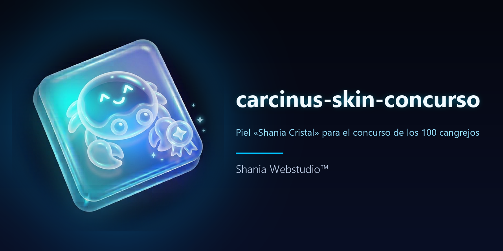
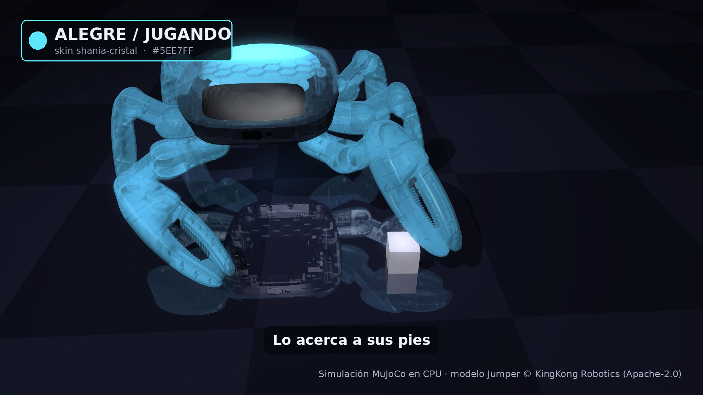

<p align="center"></p>

# carcinus-skin-concurso

Skin «shania-cristal» para el robot cangrejo **Jumper** de KingKong Robotics, hecho para el **Crab Robot Open-source Challenge 2026** (BE UNLIMITED / KingKong Robotics). Es una carcasa de cristal translúcida con un emisor de luz interior que cambia de color según 4 estados (alegre, esperando, batería baja, cargando). Todo es simulación MuJoCo en CPU, sin hardware.

## Vídeo del concurso
[](video/video_concurso.mp4)

- [`video/video_concurso.mp4`](video/video_concurso.mp4): 1920×1080, 27 s, sin audio.
- [`video/video_concurso_vertical.mp4`](video/video_concurso_vertical.mp4): 1080×1920 (9:16), 27 s, sin audio.
- Qué pasa: un cubo cae cerca del robot y la pinza delantera izquierda lo barre hasta sus pies, mientras la luz de la carcasa pasa por los 4 estados (batería baja y cargando son **ilustrativos**). El movimiento es programado (cinemática inversa + física de contactos de MuJoCo), no una política entrenada.
- Cómo se hizo y cómo se reproduce: [`video/LEEME.md`](video/LEEME.md). Inscripción: [`docs/inscripcion/INSCRIPCION.md`](docs/inscripcion/INSCRIPCION.md).

## Qué hay
| Carpeta | Contenido |
|---|---|
| `skin/shania-cristal/` | `skin.json` (materiales, emisor, paleta y estados) y `shania_cristal.py` (aplica el skin al modelo del kit con MjSpec) |
| `skin/exportar_xml.py` | genera el XML del robot con el skin para usarlo con `--model` en el reproductor y el entrenamiento del kit |
| `skin/` | demostración de los 4 estados del 14-10-2026 (`video.mp4` y capturas) y sus notas (`LEEME.md`) |
| `video/` | escena, vídeos y capturas del concurso |
| `docs/` | inscripción, plan de entrenamiento con GPU y partes de trabajo |

El modelo del robot Jumper **no se incluye**: los scripts lo leen del kit clonado aparte (<https://github.com/KingKongRobotics/jumper>, Apache-2.0). Los vídeos y capturas sí están renderizados con ese modelo. El formato `skin.json` es propio de este prototipo y no está validado contra el esquema de `jumper-design`.

## Reproducir
```
git clone --depth 1 https://github.com/KingKongRobotics/jumper ~/kit/jumper
pip install mujoco numpy pillow          # y ffmpeg + libosmesa6 para el render en CPU
MUJOCO_GL=osmesa python3 video/escena_concurso.py --kit ~/kit/jumper --out video/salida
```

## In English
Glass-shell skin for the Jumper crab robot (KingKong Robotics open-source kit, Apache-2.0), made for the Crab Robot Open-source Challenge 2026. The inner light changes with 4 states. In the video, the robot sweeps a dropped cube back to its feet. MuJoCo simulation on CPU; the motion is scripted (inverse kinematics + contact physics) and was written with AI assistance (Claude). Not real hardware, not AI-generated video. The robot model is not copied here: the scripts read it from a separate clone of the kit. #Jumper #CrabRobot #OpenSourceRobot

## Licencia
Apache 2.0 (ver [LICENSE](LICENSE) y [NOTICE](NOTICE)). © 2026 Shania Webstudio. Las marcas y logotipos de Shania no se licencian. Robot Jumper: © 2026 KingKong Robotics, Apache-2.0.
